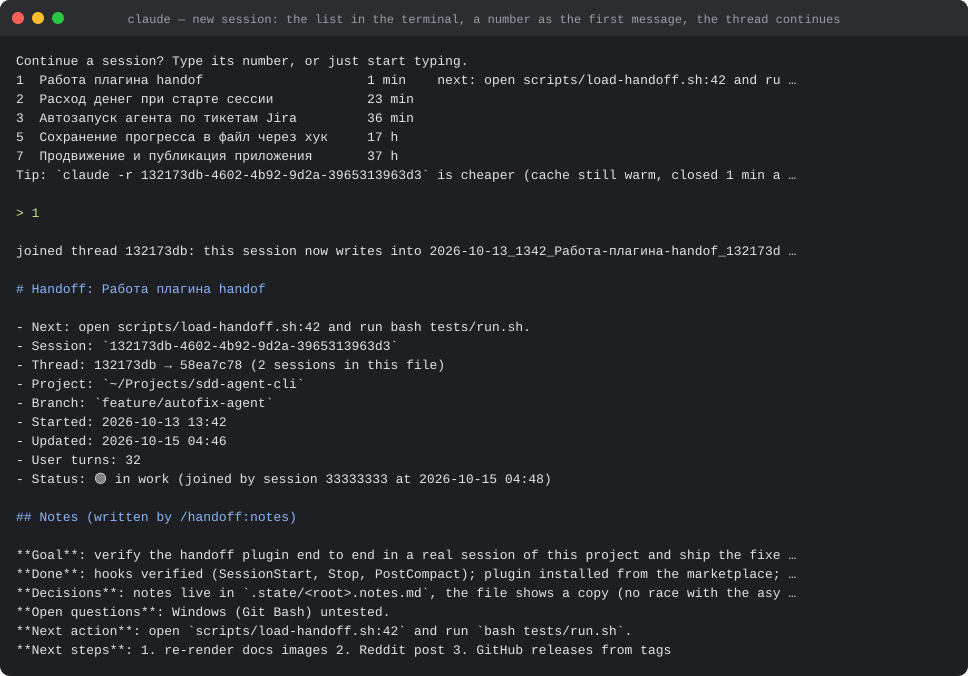
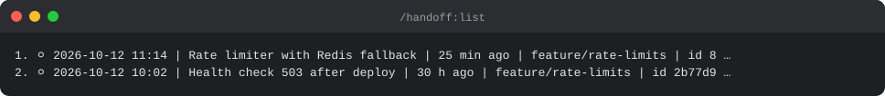
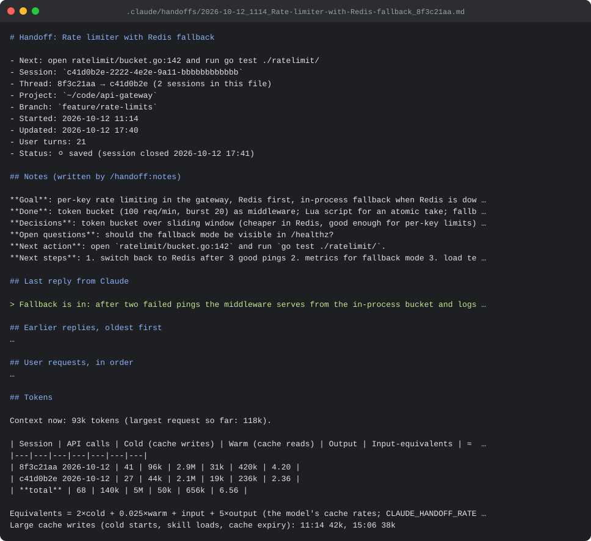

<h1 align="center">claude-code-handoff</h1>

<p align="center"><b>Pick up a Claude Code session where you left it, without paying to replay it.</b></p>

<p align="center">
  <a href="https://github.com/DaniilBrusnikUa/claude-code-handoff/blob/main/LICENSE"></a>
  
  
  
</p>

A Claude Code plugin that keeps one markdown **handoff file** per thread of work, written by shell hooks from the transcript Claude Code already stores on your machine. Nothing is sent to the model to write it; 1–4k tokens load it; the status line always shows where it is.

```
claude plugin marketplace add DaniilBrusnikUa/claude-code-handoff
claude plugin install handoff@claude-code-handoff
```

Restart Claude Code once. That is the whole setup.

**What does a cold resume cost you?** Real numbers from the session this plugin was built in (Claude Fable 5.1, fixed prefix 42k tokens, history 232k):

| Coming back after a break | What is paid | Token equivalents | USD at API prices |
|---|---|---|---|
| `--resume` within the hour | warm read of the history | 0.025 × 232k = 5.8k | 0.06 |
| **New session + handoff** | cold prefix + the handoff | 2 × 42k + ~1k ≈ 85k | 0.85 |
| `--resume` after the hour | cold write of the history | 2 × 232k = 464k | 4.64 |

Factors are the model's cache rates: a read costs 0.025× the input price, a 1-hour cache write 2×; USD at $10 per million input tokens. Your prefix and rates will differ; the arithmetic does not.

<p align="center"></p>

---

**Contents:** [Why](#why) · [What you get](#what-you-get) · [Quick tour](#quick-tour) · [Commands](#commands) · [The file](#the-file) · [Modes and settings](#modes-and-settings) · [Status bar](#status-bar) · [How it works](#how-it-works) · [Compared to](#compared-to) · [FAQ](#faq) · [Uninstall](#uninstall) · [Requirements](#requirements) · [Development](#development)

## Why

Claude remembers nothing between requests: every turn re-sends the whole session, and the prompt cache is what makes that affordable. A cache entry lives one hour on a subscription. Come back after that and the **whole history is re-sent cold at double price**. The handoff file gives a fresh session what it needs for 1–4k tokens.

A new session with the handoff beats a cold resume (table above) as soon as the conversation is longer than the fixed prefix (about 40–50k tokens), and the gap grows with every turn. On a subscription the same arithmetic applies to your usage limit instead of dollars. The plugin tells you at session start when resuming is still the cheaper option.

## What you get

| | |
|---|---|
| **Zero tokens to write** | A `Stop` hook rebuilds the file after every reply with `bash`, `jq` and `git`. The model is never called. |
| **Always current** | Written after every reply, not at session end. A killed terminal or a sleeping laptop loses nothing. |
| **One file per thread** | A new session gets its own file. Continue an old one with `/handoff:load` and the session **joins that file**: requests, replies, compaction summaries and token totals of all its sessions, in order. |
| **Compact start** | The next session begins with the notes, the latest compaction summary, the last reply and an index of recent threads: typically 1–4k tokens depending on notes length. The full file is one read away. |
| **Compaction summaries kept** | When Claude Code compacts the context it writes a summary you already paid for; a `PostCompact` hook stores it in the file. |
| **Cost hints, zero tokens** | Previous session closed less than an hour ago? The start message gives you `claude -r <id>`. Still open in another terminal? It says that instead. Resuming after the cache expired? It tells you what that cold resume costs. The status bar shows context % and suggests `/handoff:notes` at 70% context or 90% of the 5-hour limit. |
| **Pick from a menu** | `/handoff:list` shows the project's threads with an arrow-key menu; `/handoff:load` continues the chosen one. |
| **Status everywhere** | Files carry 🟢 in work / ⚪ saved; the status bar shows which file this session writes to; `/handoff:status`, `/handoff:open`. |
| **Token accounting** | Per thread: API calls, context size, cold cache writes, warm reads, output, and the moments when large cold writes happened (skill loads, cache expiry). Cold starts stop being invisible. |
| **Silent in scripts** | `claude -p …` and SDK sessions write nothing and load nothing. No files pile up from automation. |
| **Hygiene** | Common secret shapes redacted before they reach the file; the directory added to the clone's `.git/info/exclude`; the newest 50 files kept; nothing leaves your machine. |

## Quick tour

1. **Start.** `SessionStart` gives Claude the compact handoff of the newest thread and prints a numbered index of recent threads in the terminal, with the cache hint (image above). A bare number as the first message continues that thread, the same as `/handoff:load <n>`; `new` starts fresh. Nothing is injected on `claude -r` (the history is there) or in `claude -p` runs; a cold `claude -r` gets a one-line cost note instead. If the newest handoff was written on another branch, the start says so.
2. **Work.** After every reply the `Stop` hook rewrites the thread's file and `LATEST.md`. The session's title becomes part of the file name as soon as Claude Code generates it.
3. **Compaction.** `PostCompact` stores the summary and refreshes the file.
4. **Switch.** `/handoff:list`, pick a thread, and this session joins it. Its own file is dropped because its history is in the thread now, unless other sessions had joined that file: then it stays and they move along.

<p align="center"></p>

5. **Notes.** `/handoff:notes` fills the one block a script cannot write: goal, done, decisions and why, next action. Set `CLAUDE_HANDOFF_AUTO_NOTES=context` and it happens by itself at 60% and 85% of the context window, one model turn each.
6. **Exit.** `SessionEnd` removes the session's open mark. The file shows 🟢 while any session of the thread is open, ⚪ saved once all are closed.

## Commands

| Command | What it does |
|---|---|
| `/handoff:list` | Numbered list of this project's threads and an arrow-key menu to continue one. |
| `/handoff:load <n>` | Continue a thread by number, session id or part of its name; this session joins its file. Without an argument: the menu. |
| `/handoff:notes` | Claude writes goal, state, decisions and why, rejected options, open questions, next steps into the notes block. Run it before a long break or `/clear`. One normal turn. |
| `/handoff:status` | File, thread, status and open sessions of the current session. |
| `/handoff:open` | Open the current file in the default app and print its path. |

## The file

<p align="center"></p>

```
# Handoff: <title of the thread's first session>
- Session: <id of the session that wrote last>
- Thread: <id> → <id> (2 sessions in this file)     when later sessions joined
- Project / Branch / Started / Updated / User turns
- Status: 🟢 in work (open: <ids>) | ⚪ saved (session closed <time>)

## Notes (written by /handoff:notes)            preserved across rewrites
## Compaction summary (written by Claude Code)  the latest; all of them under .state/
## Last reply from Claude                       in full
## Earlier replies, oldest first                last four end-of-turn replies, shortened
## User requests, in order                      last 25 prompts, one line each
## Files changed / Files read
## Git                                          branch, working tree, last 5 commits
## Tokens                                       calls, context, cold / warm cache, output, large cold writes
## Archived history                             only when a transcript was deleted (see FAQ)
```

Files are named `<start date>_<time>_<title>_<id>.md`; `LATEST.md` is a copy of the most recently written one.

## Modes and settings

Settings are environment variables. Put them in the `env` block of `~/.claude/settings.json` (all projects) or `.claude/settings.local.json` (one project).

| Variable | Default | Meaning |
|---|---|---|
| `CLAUDE_HANDOFF_ROOT` | `cwd` | What counts as "the project". `cwd`: the directory the session started in. `git`: the repository root, so sessions started in subfolders of one repo share one folder. |
| `CLAUDE_HANDOFF_IN_PROJECT` | `true` | `true`: `<project>/.claude/handoffs/`. `false`: `~/.claude/handoffs/<project-slug>/`, nothing written inside the project. |
| `CLAUDE_HANDOFF_DIR` | unset | Explicit directory (absolute, `~/…`, or relative to the project). Overrides the two above. |
| `CLAUDE_HANDOFF_AUTOLOAD` | `compact` | What the session start injects. `compact`: notes, compaction summary, last reply, index. `full`: the whole file. `false`: nothing. |
| `CLAUDE_HANDOFF_AUTO_NOTES` | `0` | `context`: when the context crosses 60% and then 85% of the window (once per threshold, re-armed after a compaction) Claude is kept going one more step to update the notes, so they are fresh when compaction comes. `N`: every N user turns. Each update is a model turn. `CLAUDE_HANDOFF_AUTO_NOTES_AT="60,85"`, `CLAUDE_HANDOFF_CONTEXT_WINDOW=200000` tune it. |
| `CLAUDE_HANDOFF_HEADLESS` | unset | `true` runs the plugin in `claude -p` / SDK sessions too. |
| `CLAUDE_HANDOFF_KEEP` | `50` | Thread files kept per project (counts files, not days); older ones deleted, and only handoff files, only while the directory holds nothing else. Values 1–4 are raised to 5; `0` disables. |
| `CLAUDE_HANDOFF_INDEX` | `5` | Threads listed at session start. |
| `CLAUDE_HANDOFF_CONTEXT_CHARS` | `9500` | Max characters injected at start (Claude Code caps hook output at 10,000; blocks shrink to fit). |
| `CLAUDE_HANDOFF_NUDGE_CONTEXT` / `_NUDGE_LIMIT` | `70` / `90` | Status bar suggests `/handoff:notes` from this context % / 5-hour usage %. `0` disables. |
| `CLAUDE_HANDOFF_COMPACT_CHARS` | `3000` | Max characters per block in compact autoload. |
| `CLAUDE_HANDOFF_LOAD_CHARS` | `16000` | Max characters in full autoload. |
| `CLAUDE_HANDOFF_COMPACT_SUMMARY_CHARS` | `6000` | Max characters of the compaction summary kept in the file. |
| `CLAUDE_HANDOFF_MAX_PROMPTS` / `_PROMPT_CHARS` | `25` / `400` | User requests kept, and characters per request. |
| `CLAUDE_HANDOFF_MAX_REPLIES` / `_REPLY_CHARS` / `_SHORT_REPLY_CHARS` | `5` / `4000` / `800` | End-of-turn replies kept; characters of the newest; of each older one. |

Example, central storage for every project:

```json
{ "env": { "CLAUDE_HANDOFF_IN_PROJECT": "false" } }
```

## Status bar

<p align="center"></p>

`scripts/statusline.sh` prints one line from Claude Code's status-line JSON: the file this session writes to (the path is clickable in IDE terminals), the context percentage, and a `/handoff:notes` nudge when the context or the 5-hour limit gets high. These fields reach only the status line, never hooks, so this is the one place the plugin can warn without spending a token. Use it as the status line:

```json
{ "statusLine": { "type": "command", "command": "\"$(ls -d ~/.claude/plugins/cache/claude-code-handoff/handoff/*/ | sort -V | tail -1)scripts/statusline.sh\"" } }
```

or, if you already have a status script, call `handoff-status.sh --short <session_id> <cwd>` from it and print the result as one more line.

## How it works

| Event | Script | What happens |
|---|---|---|
| `Stop` (every reply, async) | `scripts/save-handoff.sh` | Waits up to 2 s for the transcript to flush, takes the final reply from the hook's `last_assistant_message`, renders every session of the thread from their transcripts under a per-thread lock, copies the notes from `.state/<root>.notes.md`, writes the file atomically, copies `LATEST.md`, applies retention, records the open mark. Every delete, rename or join is logged in `.state/audit.log`. |
| `PostCompact` | `scripts/save-compact.sh` | Stores `compact_summary` under `.state/<session>.compact.md` (wrapper tags stripped, inner headings demoted) and refreshes the file. |
| `SessionStart` (`startup`, `clear`, `resume`) | `scripts/load-handoff.sh` | Prints the compact handoff of the newest thread, the index (a bare number as the first message loads that thread), the cache and branch hints. On `resume` only a cost note, and only when Claude Code reports the cache as expired. |
| `SessionEnd` | `scripts/mark-closed.sh` | Removes the open mark; status follows the remaining sessions. |
| `Stop` with `CLAUDE_HANDOFF_AUTO_NOTES=N` | `scripts/auto-notes.sh` | Every N turns asks Claude to update the notes block. |
| Skills | `skills/*/SKILL.md` | `list`, `load`, `notes`, `status`, `open`. Scripts find the current session through `CLAUDE_CODE_SESSION_ID`, which Claude Code sets for every shell it starts. |

State lives next to the files in `.state/`: `<root>.notes.md` (the notes, source of truth), `<root>.members` and `<session>.adopt` (thread membership), `<session>.transcript`, `<session>.open` / `.closed`, `<session>.compact.md`, `<root>.frozen.md` (snapshot), `<session>.index` (menu numbers as printed), `audit.log` (every delete, rename, join).

**Threads.** A thread is a root session plus the sessions that joined it with `/handoff:load`. The writer renders all their transcripts, in order, into the root's file, so two open sessions of one thread keep the same file. The file keeps the root's title.

**Headless runs.** `claude -p …` and SDK sessions are new sessions every time. The hooks detect them (`CLAUDE_CODE_SESSION_ATTENDED=0`, `CLAUDE_CODE_ENTRYPOINT=sdk-*`, or the transcript's own `entrypoint`) and do nothing.

**What it runs, sends and fetches (disclosure for reviewers and the curious).** Hooks run the bash scripts in `scripts/` with `jq` and `git` from your PATH. They read the session transcript under `~/.claude/projects/`, the hook's stdin JSON, and `git` state of the project; they write markdown files and small state files under the handoff directory, a line in the clone's `.git/info/exclude`, and nothing else. `/handoff:open` runs `open` (macOS) or `xdg-open` (Linux) on the handoff file. No network access, no telemetry, no package installs, no credentials read or sent, no changes to Claude Code settings or permissions.

**Privacy.** Everything is local: the scripts read `~/.claude/projects/` and write markdown next to your project. Requests and replies are copied as text, so `scripts/scrub.jq` redacts common secret shapes: API keys (`sk-…`, `sk_live_…`, AWS, Google, GitHub, GitLab, Slack), JWTs, bearer tokens, private keys, credentials in URLs and `password=` / `token=` / `*_secret_*=` style values, in replies, requests, summaries and the git section. A guard against accidental leaks, not a guarantee: review a file before sharing it, and keep secrets out of the notes. The directory is added to the clone's `.git/info/exclude`, which is local and never committed.

## Compared to

| | claude-code-handoff | `claude --resume` | memory plugins that summarize with a model |
|---|---|---|---|
| Tokens to save progress | 0 | 0 | a model call per save |
| Cost of coming back after the cache expired | prefix + 1–4k tokens | the whole history, cold, at 2× | prefix + their summary |
| Survives a killed terminal | yes, written after every reply | yes | depends on the hook used |
| Knows when resuming is cheaper | yes, says so at start; warns on a cold resume | n/a | no |
| Several sessions in one file | yes (threads) | no | varies |
| Shows cold starts and cache usage | per thread | no | no |
| Dependencies | bash, jq, git | none | often Node or Python |

The plugin does not replace `--resume`: within the hour, resuming is the cheapest option, and the start hint tells you so.

## FAQ

**Does it change anything in my repository?** No. Files go to `.claude/handoffs/` and that path is excluded through `.git/info/exclude`, which is per-clone and never committed. Set `CLAUDE_HANDOFF_IN_PROJECT=false` to keep files outside the project entirely.

**Why is there a file I did not ask for?** Every interactive session writes one after its first reply. It is replaced, not accumulated: one file per thread, the newest 50 threads kept.

**I picked a thread with `/handoff:load`, where did the new session's file go?** It joined the thread. Its history is in the thread's file now; a separate file would duplicate it.

**What happens after Claude Code deletes old transcripts?** Claude Code keeps transcripts `cleanupPeriodDays` (30 by default). A single-session file is never rewritten after its session ended, so it keeps its content. A thread file is rewritten by every session in it, so the plugin keeps a snapshot of each complete render in `.state/<root>.frozen.md`; when a member's transcript is gone, the snapshot is appended as `## Archived history` instead of being lost.

**Why isn't the notes block written automatically?** Everything a script can know is already automatic. The notes need judgment (what mattered, what was rejected, what comes next), and that is a model turn. Run `/handoff:notes` when it is worth it, or set `CLAUDE_HANDOFF_AUTO_NOTES=context` to have it done at 60% and 85% of the context window, right before the information would be compacted away.

**Two terminals in the same project?** Each session has its own file unless it joined a thread. The index at start lists both; the status says which are open.

**Windows?** Untested. The scripts are plain bash + jq; Git Bash or WSL should work. Reports welcome.

## Uninstall

`claude plugin uninstall handoff@claude-code-handoff` (or remove it in `/plugin`). Nothing else runs afterwards. What stays, and how to remove it:

- `.claude/handoffs/` in each project (the handoff files, `LATEST.md`, `.state/`): delete the directory.
- The line `/.claude/handoffs/` in the clone's `.git/info/exclude`: delete it if you want.
- `~/.claude/handoffs/` when `CLAUDE_HANDOFF_IN_PROJECT=false` was used.
- The `statusLine` entry in `~/.claude/settings.json` if you added it.

## Requirements

`bash`, `jq`, `git`. Present on macOS and most Linux distributions.

## Development

```
git clone https://github.com/DaniilBrusnikUa/claude-code-handoff
claude --plugin-dir /path/to/claude-code-handoff
```

Every script accepts the hook's JSON on stdin, so they can be tested without a session:

```
jq -nc '{session_id:"abc", transcript_path:"/path/to/session.jsonl", cwd:"/path/to/project"}' | scripts/save-handoff.sh
```

`tests/run.sh` runs 50 checks on synthetic fixtures in a temp directory (render stability, notes markers, retention guard, thread join, secret scrubbing). The images in `docs/` are rendered from real plugin output on a demo project with `docs/render-terminal.py`.

See [CHANGELOG.md](CHANGELOG.md). Issues and pull requests welcome.

## License

MIT
